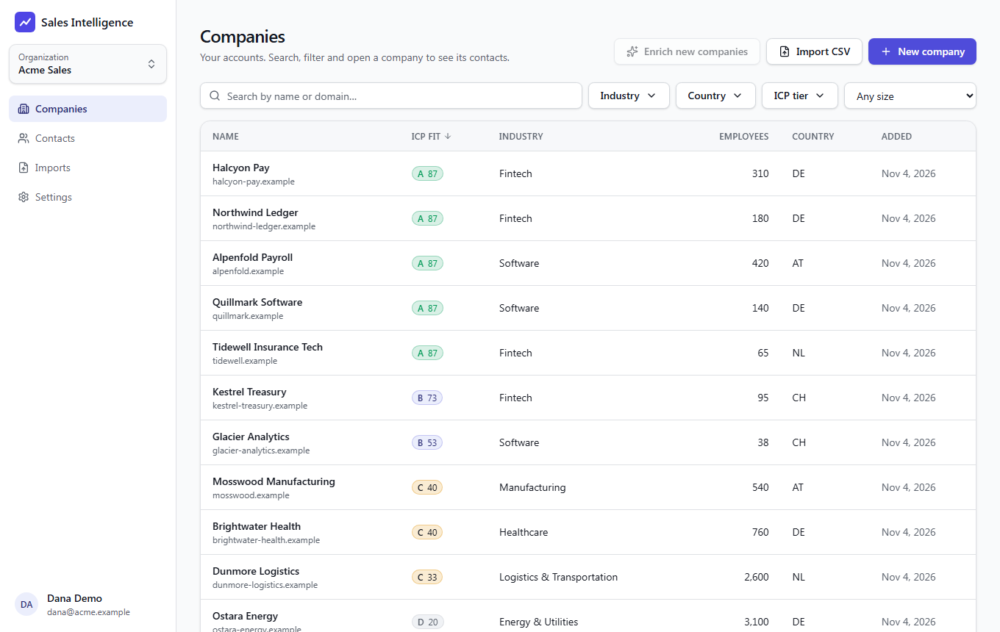
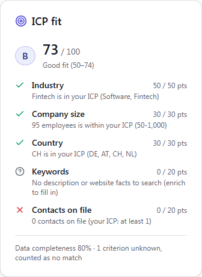
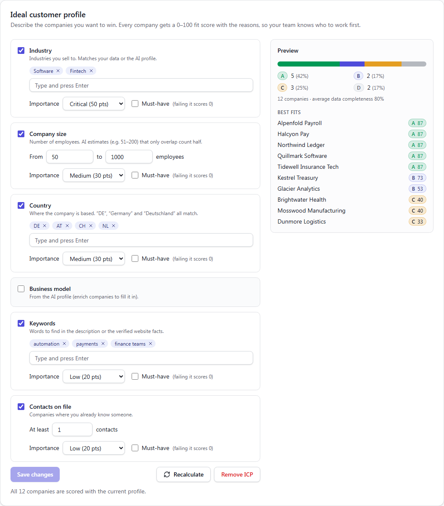
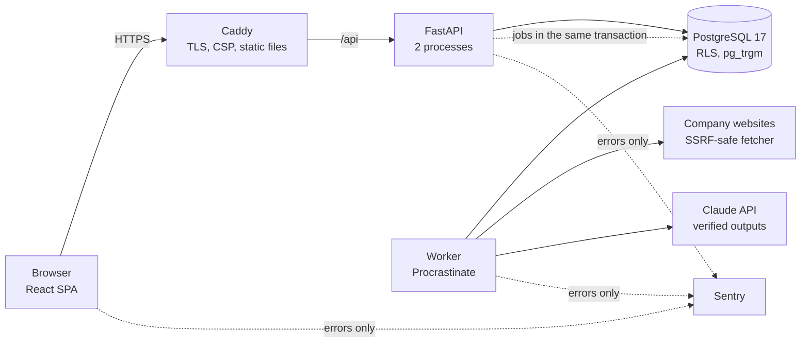

# Sales Intelligence Agent

[](https://github.com/dhamze/sales-intelligence-agent/actions/workflows/ci.yml)

An AI-assisted sales intelligence platform for B2B sales teams: import an account list, enrich
each company from public sources, score it against your ideal customer profile with an
explainable breakdown, and get grounded AI account briefs with cited sources.

> **Status:** MVP complete (Phases 0–7) and production-ready (Phase 8): containerised, hardened,
> monitored, with encrypted backups and a tested restore. Public demo: coming soon.



## What it does

1. **Import** your accounts from CSV (column mapping, preview, de-duplication by domain, merge
   that never overwrites your data), or start with fictional sample data.
2. **Enrich** each company from its own website: an AI extracts a profile where every fact
   carries a quote, and quotes that can't be found on the page are thrown away.
3. **Score** every company against your ideal customer profile (ICP): a 0–100 fit with a tier
   and a plain-language reason for every point.
4. **Brief:** an AI-written account brief and outreach angle where every claim links to the
   exact sentence it came from.

| ICP fit, explained | ICP builder with live preview |
|---|---|
|  |  |

## Engineering highlights

- **Tenant isolation in the database itself.** Forced Row-Level Security on every tenant table;
  the API runs as a role that cannot bypass it; guard tests fail if a new table or route skips
  the rules ([ADR-0007](docs/adr/0007-database-roles-and-rls-mechanics.md)).
- **Grounded AI.** Structured outputs with verbatim evidence, mechanically verified against the
  source text; prompt-injection test cases; an eval harness with a 90% citation target
  ([ADR-0010](docs/adr/0010-grounded-extraction.md), [ADR-0012](docs/adr/0012-cited-account-briefs.md)).
- **Explainable scoring.** A pure, exhaustively tested rules engine; unknown data counts as no
  match but is labelled ([ADR-0011](docs/adr/0011-explainable-icp-scoring.md)).
- **Safe web fetching.** SSRF protection at connect time (incl. DNS rebinding), robots.txt
  ([ADR-0009](docs/adr/0009-ssrf-safe-fetching.md)).
- **Cost and abuse controls.** Rate limiting in PostgreSQL, AI off for public signups, a global
  monthly AI budget enforced by API and worker ([ADR-0013](docs/adr/0013-abuse-and-cost-protection.md)).
- **Production operations.** Non-root read-only containers, strict CSP, privacy-first error
  monitoring, near-zero-downtime deploys (1 failed request of 217 during an upgrade), nightly
  encrypted backups with a tested restore ([operations runbook](docs/operations.md),
  [security](docs/security.md)).
- **Tests at every level:** 520+ backend tests (unit, integration against real PostgreSQL),
  70+ frontend component tests, Playwright end-to-end journeys through the real worker, plus
  dependency audits, secret scanning and image builds in CI.



## Documentation

- [Product brief](docs/product.md): problem, users, MVP scope
- [Architecture](docs/architecture.md): system design, technology choices, roadmap
- [Architecture Decision Records](docs/adr/): why key decisions were made (15 ADRs)
- [Operations runbook](docs/operations.md): deploy, roll back, monitor, back up, restore
- [Security](docs/security.md): threat model, review results, accepted risks

## Tech stack

Python 3.13 · FastAPI · SQLAlchemy 2 · PostgreSQL 17 · Procrastinate · Claude API ·
React 19 + TypeScript + Vite · TanStack Router/Query · Tailwind · Docker · Caddy ·
GitHub Actions · Sentry

## Prerequisites

- [uv](https://docs.astral.sh/uv/) (Python package and project manager)
- Docker Desktop
- Node.js 22+

## Getting started

Run all commands from the repository root.

```bash
# 1. Install Python 3.13 (if needed) and all locked dependencies into .venv
uv sync

# 2. Install the git hooks (lint, format, type check, secret scan on every commit)
uv run pre-commit install

# 3. Create your local configuration, then set a POSTGRES_PASSWORD of your choice
cp .env.example .env

# 4. Start PostgreSQL (first run also creates the sia_dev and sia_test databases)
docker compose up -d db

# 5. Apply database migrations
uv run alembic -c backend/alembic.ini upgrade head

# 6. Run the API with auto-reload
uv run uvicorn sia.main:create_app --factory --reload

# 7. In a second terminal: install and run the web app
cd frontend
npm ci
npm run dev
```

To enrich companies and write briefs with AI, also run the worker
(`uv run python -m sia.worker`) and put your `ANTHROPIC_API_KEY` in `.env`. Without a key
everything else works; AI features show as "not configured". For an offline demo, set
`SIA_LLM_PROVIDER=fake` and `SIA_FETCH_PROVIDER=fake`. An empty workspace offers
"Load sample data" (12 fictional companies).

Open <http://localhost:5173> and create an account. The dev server forwards `/api/*` to the
backend, so the browser talks to a single origin and the session cookie works as in production.

Then open <http://127.0.0.1:8000/docs> for interactive API docs, or
<http://127.0.0.1:8000/health/ready> to confirm the database connection.

> Already had the database running before Phase 2? Create the restricted app role once:
> `docker compose up -d db` (picks up the new setting), then
> `docker compose exec db bash /docker-entrypoint-initdb.d/02-create-app-role.sh`

## Everyday commands

| Task | Command |
|---|---|
| Run all tests (needs the database running) | `uv run pytest` |
| Run unit tests only (no database) | `uv run pytest -m "not integration"` |
| Lint / format / type check | `uv run ruff check .` · `uv run ruff format .` · `uv run mypy` |
| Run all pre-commit hooks | `uv run pre-commit run --all-files` |
| Create a migration after changing models | `uv run alembic -c backend/alembic.ini revision --autogenerate -m "describe change"` |
| Apply / roll back one migration | `uv run alembic -c backend/alembic.ini upgrade head` · `... downgrade -1` |
| Run the background worker (enrichment jobs) | `uv run python -m sia.worker` |
| Seed demo companies into your org | `uv run python -m sia.scripts.seed_companies --email you@example.com --count 50000` |
| Stop the database (keeps data) | `docker compose stop` |
| Delete all local database data | `docker compose down -v` |
| Add a backend dependency | `uv add --package sia-backend <name>` |
| Add a dev tool | `uv add --dev <name>` |
| Frontend: type check / lint / unit tests | `npm run typecheck` · `npm run lint` · `npm test` (in `frontend/`) |
| Regenerate frontend API types after backend changes | `npm run api:sync` (in `frontend/`) |
| Live AI quality check (real API + websites; costs money) | `uv run pytest backend/tests/evals --run-live-llm -s` |
| End-to-end tests (real browser + API + DB) | `npm run build && npm run e2e` (in `frontend/`, database running) |

## Repository layout

```
backend/
  src/sia/
    main.py         App factory
    core/           Config, logging, database, errors, request middleware
    modules/
      health/       Liveness and readiness probes
      identity/     Users, organisations, memberships, sessions, auth API
      companies/    Companies (accounts), domain normalisation, search
      contacts/     Contacts linked to companies
      imports/      CSV import: parse, map, preview, merge
      enrichment/   SSRF-safe website reading, AI profile extraction with evidence
      scoring/      ICP definition, pure scoring engine, rescoring
      insights/     Cited AI account briefs, AI usage
      protection/   Rate limiting, AI access and monthly AI budget
      demo/         Fictional sample data
    ai/             LLM client (Claude / fake), pricing, cost log
    worker/         Background worker (Procrastinate job queue)
    scripts/        Operator and developer scripts
  migrations/       Alembic database migrations
  tests/unit/       Fast tests, no database
  tests/integration/  Tests against a real PostgreSQL
  tests/evals/      AI quality evals (offline harness + opt-in live runs)
frontend/
  src/routes/       Pages (file-based routing)
  src/features/     Feature code (auth, shell, companies, ...)
  src/components/   Shared UI components
  src/lib/api/      Typed API client generated from the backend's OpenAPI schema
infra/postgres/     Database init scripts
deploy/             Production images, Caddy, compose stack, server setup, deploy/backup/restore
docs/               Product brief, architecture, ADRs, operations, security
compose.yaml        Local infrastructure (PostgreSQL + pgvector)
pyproject.toml      uv workspace root and shared tool configuration
```

## Security model (summary)

Full threat model and review results: [docs/security.md](docs/security.md).

- The API connects as `sia_app`, a database role that cannot bypass Row-Level Security; tenant
  isolation is enforced by PostgreSQL itself ([ADR-0007](docs/adr/0007-database-roles-and-rls-mechanics.md)).
- Passwords: Argon2id. Sessions: random 256-bit tokens in `HttpOnly`, `SameSite=Lax` cookies,
  stored only as SHA-256 hashes, revocable, idle and absolute expiry.
- CSRF: `Origin` header check on state-changing requests. Brute force: per-email and per-IP
  login throttling. Security events are logged by ID, never with passwords or emails.

## Troubleshooting

- **Slow database connections on Windows:** use `POSTGRES_HOST=127.0.0.1`, not `localhost`.
  Windows tries IPv6 (`::1`) first, which Docker does not listen on, adding ~2 s per connection.
- **`docker` not found:** open a new terminal after installing Docker Desktop.
